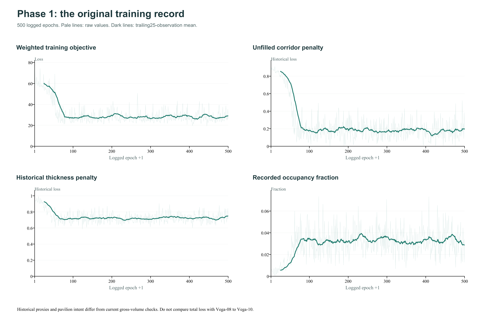
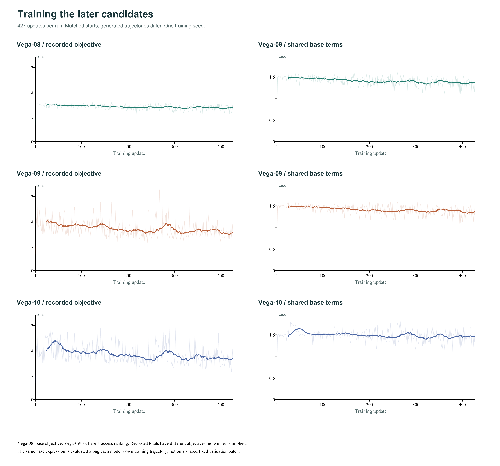
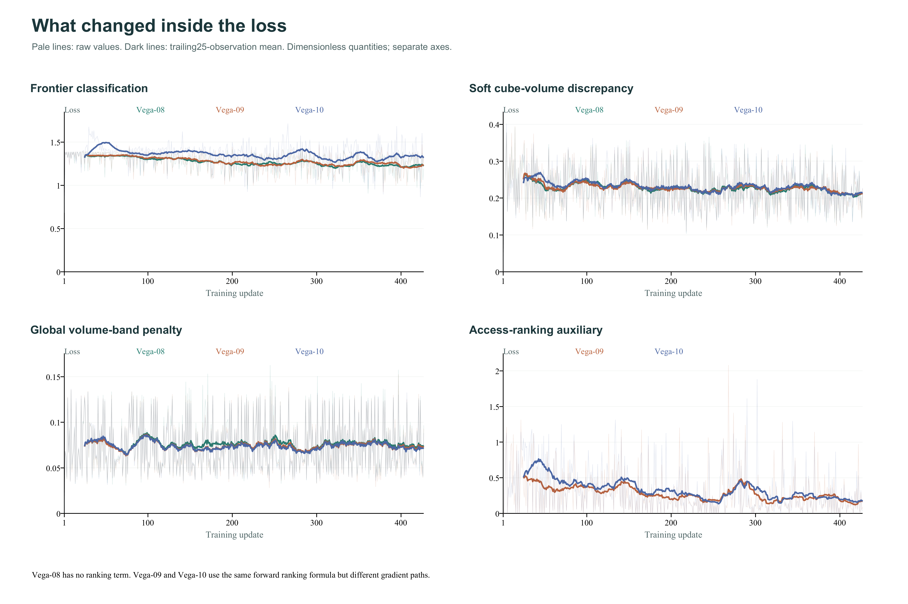
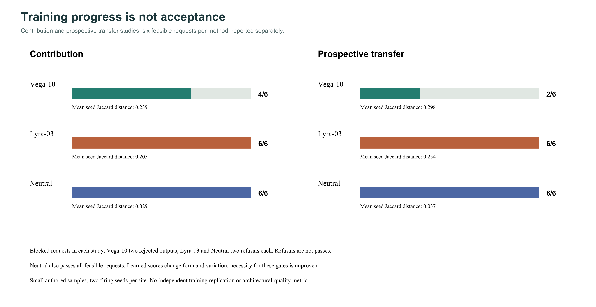

# Growing architectural volume with neural cellular automata

*Phase 2: training curves, procedural guidance, and what the comparisons actually show*

**Artin Lesani Abdi**

In [the first part of this experiment](https://artinlesani.substack.com/p/growing-architecture-from-constraints), I asked whether an architectural form could grow from constraints instead of a sketch. A small neural cellular automaton learned a repeated local rule, conditioned on buildings, access points and available space. The results were crude, but they gave the project something concrete to question.

The next phase made that question more demanding. An attractive output was no longer enough. I wanted volume rather than a thin connection, clearer geometric tests, and a way to tell what the learned rule contributed compared with the procedures around it.

The strongest result is also a qualification of my original framing: the current hybrid system passes more of our tested cases than the learned baseline, but a procedural control with the learned signal removed also passes. Learning changes the forms we get. These experiments have not yet shown that learning is necessary for the geometric checks we use.

## From a pavilion to gross building volume

The original experiment sought pavilion-like extensions and treated thickness as something to restrain. That intent became too narrow for the next phase. A connection could satisfy a circulation objective while looking like a line or a platform. It did not necessarily have the depth I wanted to investigate.

The current object of study is **gross building volume**. An occupied voxel represents part of an overall mass, leaving interiors, construction and program for later. It does not represent a solid block of building material. We can investigate the depth, distribution and connections of a volume without pretending that it already contains usable rooms.

This also changes how thickness is evaluated. The current bulk test asks whether at least 90% of the occupied cells belong to the union of fully occupied 3 × 3 × 3 cubes. At our 0.8 m voxel size, those cubes span 2.4 m. This encourages substantial mass; it is not a structural wall-thickness calculation. The old thickness loss and this new check should not be read as the same quantity.

## What the original training curve tells us

*Figure 1. The original 500 logged epochs. Pale traces show individual observations; dark traces show a trailing mean of 25 observations. These are historical training proxies, not scores under the current massing protocol.*

The original record shows a rapid early change followed by a noisy plateau. Mean weighted loss falls from 60.41 over the first 25 observations to 28.85 over the final 25. The unfilled-corridor penalty falls from 0.857 to 0.193 over the same windows. The historical thickness penalty falls much less, from 0.930 to 0.748.

Those numbers explain why the early experiment felt promising and unfinished. The optimization found a way to fill much more of its target corridor, but it did not resolve every competing objective. A decreasing weighted sum cannot tell us whether the result has the spatial character we intended, or whether every individual constraint passes.

## A local network inside a hybrid growth process

A conventional NCA repeatedly applies a shared local update network to a grid. The current implementation retains that learned local mechanism, but the binary mass is admitted through an explicit procedure.

We can summarize the proposal stage as:

$$
(z_t,\Delta h_t)=f_\theta\bigl(\Phi([m_t,h_t]),\Phi(c),r_t\bigr).
$$

Here, $m_t$ is binary mass, $h_t$ contains seven hidden channels, $c$ is fixed context, and $r_t$ is a remaining-budget signal. The perception operator $\Phi$ includes values and central differences along the three spatial axes. The network outputs proposal logits $z_t$ and hidden-state updates.

The mass then changes through deterministic admission:

$$
m_{t+1}=\mathcal{A}\bigl(m_t,\sigma(z_t),F_t,\Omega,C_t\bigr).
$$

$F_t$ is a stochastic firing mask, $\Omega$ is the legal domain, and $C_t$ is the current admission ceiling. The procedure ranks eligible proposals and admits connected overlapping cubes under a paced volume budget. The admission decisions are detached from differentiation. We should therefore not describe the complete binary growth process as an ordinary end-to-end differentiable rollout.

The update network is small: 61 input features, a 64-channel intermediate layer and eight outputs, implemented with pointwise convolutions. Including biases, that network has 4,488 trainable parameters. Its repeated application matters more than its size. That count describes this later network, not the approximately 13,000-parameter model discussed in Part 1.

**A quick guide to the names**

Vega names the learned generation experiments, from Vega-01 (G1) through Vega-10 (G10). Lyra names the planner-assisted variants: Lyra-03 is the system previously called G11-R3, or R3. These are public-facing aliases; the original IDs remain in the tables and research records. A higher version number does not automatically mean a better model. The first table summarizes the earlier journey; the second introduces the methods compared in this article.

**The research journey: Vega-01 to Vega-07**

| Name | Original ID / role | Short introduction |
| --- | --- | --- |
| Vega-01 | G1 / Seed growth | First learned generation of building volume from a small seed. |
| Vega-02 | G2 / Growth signal | Rebalanced the training loss to encourage growth; volume control remained a problem. |
| Vega-03 | G3 / Volume budget | Added remaining-volume feedback, a volume-band penalty and a hard admission cap. |
| Vega-04 | G4 / Cube growth | Grew overlapping 3 x 3 x 3 cubes instead of individual cells, addressing thin additions. |
| Vega-05 | G5 / Destination cues | Added distance and reachability cues toward the opposite interface; did not improve the tested result. |
| Vega-06 | G6 / Paced growth | Released the volume allowance gradually so growth did not spend its budget too early. |
| Vega-07 | G7 / Vertical variety | Broadened training examples to include more vertical variation; accuracy and stability regressed. |

**The methods compared in this article**

| Name | Original ID / role | Short introduction |
| --- | --- | --- |
| Vega-08 | G8 / Trained baseline | Increased training exposure on the broader dataset. Uses frontier classification, soft volume discrepancy and a global volume band. |
| Vega-09 | G9 / Access ranking | Adds a learning signal favoring growth that advances an access connection. Both compared score groups receive ranking gradients. |
| Vega-10 | G10 / Gradient variant | Uses the same ranking formula, but treats other-candidate scores as a fixed reference in that auxiliary gradient. Separately trained. |
| Lyra-03 | G11-R3 / Hybrid system | Reuses frozen Vega-10 weights with route planning, coverage coordination and growth guards. No additional training-loss curve. |
| Neutral | Procedural control | Keeps the Lyra-03 planner and guards, with constant positive occupancy logits and zero hidden updates. No learned signal drives growth. |

Protocols evolved across the early stages. The journey table records the development history; it is not a shared benchmark leaderboard.

## What we trained and why the losses differ

The later candidates use procedural teacher geometry during training. This is a meaningful change from the original constraint-only framing: no human-designed exemplar is copied, but there are explicit geometry-derived targets and labels. At inference, the teacher target is not supplied to the learned baseline.

The common base objective is:

$$
\mathcal{L}_{base}=\mathcal{L}_{frontier}+0.25\mathcal{L}_{volume}+\mathcal{L}_{band}.
$$

The frontier term classifies fired eligible cube origins. The volume term compares soft predicted cube occupancy with the teacher target in the relevant local windows. The band term penalizes soft total mass falling outside a permitted volume interval. The recorded update losses average the step losses across each training rollout.

Three later experiments help explain the progression:

**Vega-08:** Base objective with the revised exposure/start distribution. A reference for the later ranking experiments.

**Vega-09:** Base objective plus access ranking. Tests whether advancing toward access can be prioritized among teacher-positive candidates.

**Vega-10:** The same ranking forward value, with the other-candidate reference detached. Tests whether changing the auxiliary gradient path improves the timing of growth.

All three completed 427 updates. The saved logs verify matched row choices and starting occupancy hashes. They remain one seeded comparison: their evolving predictions and hidden states differ, and they are not independent training replications.

*Figure 2. Each row is a trained candidate: Vega-08, Vega-09 or Vega-10. Left: that candidate's recorded training objective. Right: the shared base-loss expression. Pale traces show raw updates; dark traces show trailing 25-update means. Vega-08 has no ranking auxiliary, so the left-column totals have different objectives. The right column uses the same expression along each candidate's own trajectory, not a shared validation batch.*

The ranking term makes the difference concrete. Let $A$ be advancing teacher origins and $B$ other teacher origins among eligible fired candidates:

$$
\mathcal{L}_{rank}=\log\left(1+\frac{1}{|A||B|}\sum_{a\in A}\sum_{b\in B}\exp(1+z_b-z_a)\right).
$$

When both sets exist in an active access phase, this favors advancing scores over other teacher-positive scores. Vega-09 differentiates through both groups. Vega-10 uses the same forward expression but treats the other scores as a fixed comparison reference in this auxiliary. That removes this term's direct gradient through $z_b$; the other scores can still change through the base objective and shared network parameters.

*Figure 3. Frontier, soft-volume, band and ranking components plotted separately. Vega-08 is omitted from the ranking panel because it has no such term. A zero ranking observation can mean the term was inactive; it does not necessarily mean access was solved.*

Vega-10 did not dominate every earlier reference. In its frozen final review, all nine families passed on six of twelve fresh requests at both horizons, compared with four of twelve for Vega-08 and Vega-09. Vega-10 also passed the late-growth limit across its 69 evaluated requests, while still having connection and coverage failures. The lesson was to evaluate the resulting geometry rather than promote a model because its training curve looked better.

## What the planner contributes

The current experimental system, Lyra-03, reuses the frozen Vega-10 weights. It adds a procedural route witness, coverage coordination and guarded growth. **Lyra-03 does not have a separate training-loss curve.** Its improvement is a system-level intervention, not evidence of another trained checkpoint.

To investigate contribution, we compared three methods: Vega-10 with its existing procedural admission; Lyra-03 with learned scores and planning; and a neutral control with the same Lyra-03 planner and guards, constant positive occupancy logits and zero hidden updates. The neutral control removes learned gating and ranking together.

*Figure 4. Feasible acceptance counts and mean seed Jaccard distances in two separate studies. Each study also includes two blocked requests per method: Vega-10 returns rejected outputs; Lyra-03 and neutral refuse. Refusals are reported separately and are not counted as accepted geometry.*

In the prospective transfer comparison, Vega-10 passed two of six feasible requests; Lyra-03 passed six of six. The neutral control also passed six of six. The four authored site layouts were frozen before generation and tested with two firing seeds. This is a bounded transfer result, not a broad real-site generalization claim.

Lyra-03 had more seed variation than neutral: mean Jaccard distance was 0.254 versus 0.037. This distance is one minus intersection-over-union of occupied sets. It describes how much two outputs differ, not which output is better architecture. Vega-10 had still higher variation, 0.298, while failing more requests.

The comparisons separate two questions I had initially bundled together: can the system meet the geometric contract, and what does learning contribute to the form? Planning and guards can satisfy the tested contract without learned scores. Learning influences the choices made within that framework. Its architectural value still needs a better test.

## A geometric contract rather than a validity slogan

The current evaluation retains nine families: access, coverage, facade contact, protected ground, legality, sparsity, spill, geometric support and thickness. Passing requires all nine at steps 64 and 128. For these studies, requested occupancy is 24%; the absolute occupancy-fraction error must be at most four percentage points, and growth from step 64 to 128 must be at most 5% of the step-64 mass.

These checks make a claim inspectable. They do not establish structural safety, regulatory compliance, habitability or design quality. Stability under a hard cap is not evidence that the network independently learned when to stop.

The acceptance conditions can be written directly as:

$$
\left|v_t-0.24\right|\leq0.04\quad(t\in\{64,128\}),\qquad\frac{N_{128}-N_{64}}{N_{64}}\leq0.05.
$$

Here, N is the number of occupied voxels, and v is occupied volume divided by the eligible domain volume. All nine constraint families must also pass at both horizons. A refusal is recorded separately, rather than counted as accepted geometry.

## What comes next

The project now includes a private local studio for generation, saved runs, versioned drafts and notes, and geometry exports. Failed and interrupted attempts remain part of the record. That infrastructure makes comparison easier, but does not replace scientific evaluation.

The next research direction is context-conditioned growth of architectural mass across multiple sites. A small-block context representation is prepared; neighborhood generation and evaluation are still future work. Moving from a 32³ grid to 40³ at the same 0.8 m voxel size expands the domain from 25.6 m to 32 m per edge. It does not add finer detail.

Before scaling further, I want to understand where learning earns its place: producing useful variation, adapting to unfamiliar contexts, or making decisions that a simpler procedural baseline cannot match. The experiment began with the possibility of growing architecture from constraints. It now has a clearer distinction between growth, guidance and evidence.

## Sources and companion material

- [Part 1: Growing Architecture From Constraints](https://artinlesani.substack.com/p/growing-architecture-from-constraints)
- [Project repository](https://github.com/artinlesani73-dev/Constraint-Based-Architectural-NCA)
- [Growing Neural Cellular Automata](https://distill.pub/2020/growing-ca/), the learned-local-rule foundation.
- [Outdoor Scene Extrapolation with Hierarchical Generative Cellular Automata](https://arxiv.org/abs/2406.08292), an inspiration for future hierarchy and context planning; a different task from gross building massing.

The companion technical report describes the building-scale method and evaluation. The figure package contains PNG and SVG exports, extracted training CSVs, and source hashes. Training figures come from retained logs; no illustrative or simulated loss curves are used.
